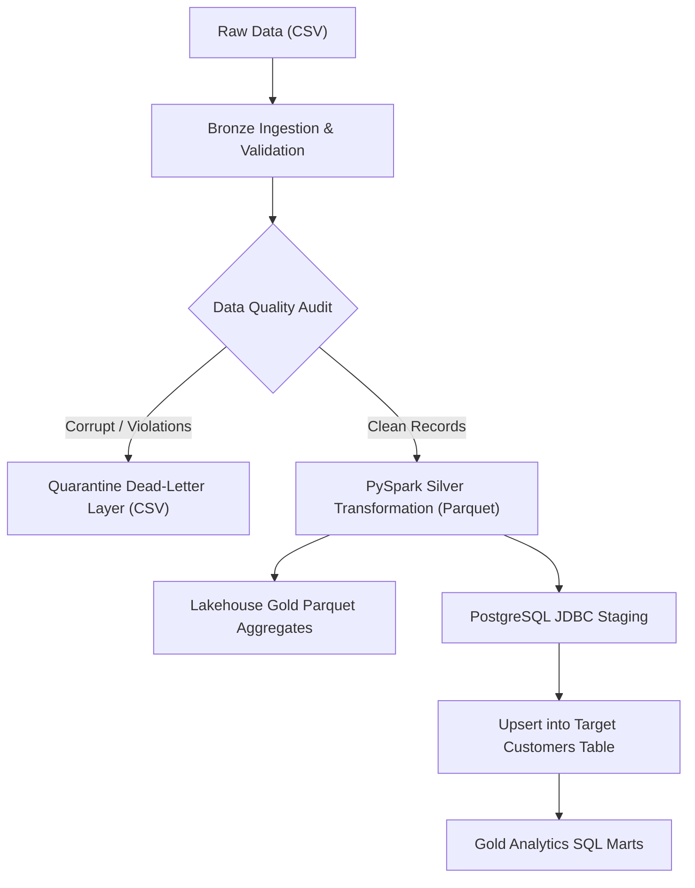

# DataFlow ⚡

[](https://www.python.org/)
[](https://spark.apache.org/)
[](https://www.postgresql.org/)
[](https://www.docker.com/)
[](https://docs.pytest.org/)
[](LICENSE)

An end-to-end, production-ready data pipeline implementing the **Medallion (Lakehouse) Architecture** (Bronze &rarr; Silver &rarr; Gold) with PySpark, PostgreSQL, Pandas, and Docker.

---

## Architecture Overview

DataFlow implements a multi-hop lakehouse pattern ensuring raw data integrity, curated transformations, dead-letter quarantine routing, and high-performance analytical aggregates:



### 1. Bronze Layer (Raw & Validation)
- Ingests raw customer records from CSV (`data/raw/customers.csv`).
- Enforces strict schema validation (`customer_id`, `name`, `email`, `age`, `city`).
- Audits null counts, duplicate records, and out-of-bounds age values.

### 2. Data Quality & Dead-Letter Quarantine
- Filters and segregates corrupt or violating records with explicit failure reason tags (`NULL_VALUES`, `DUPLICATE_ID`, `INVALID_AGE`).
- Isolates bad rows in `data/quarantine/corrupt_customers.csv` while allowing clean records to continue down the pipeline.
- Enforces configurable quality thresholds (`max_null_threshold`, `fail_on_duplicates`).

### 3. Silver Layer (Cleaned & Enriched)
- Distributed transformation using **Apache Spark (PySpark)**:
  - String normalization: whitespaces trimmed on `name` and `city`.
  - Case standardization: lowercase formatting on `email`.
  - Feature engineering: dynamic demographic segmentation into `age_group` (`Young` < 25, `Adult` 25–30, `Senior` > 30).
  - Data lineage: automated `processed_at` timestamping.
- Persisted as compressed columnar storage (`data/processed/silver/customers/*.parquet`).

### 4. Gold Layer (Lakehouse Parquet & Warehouse Data Mart)
- **Lakehouse Parquet Marts**:
  - `data/processed/gold/city_summary/`: Aggregated customer counts by city.
  - `data/processed/gold/age_summary/`: Aggregated customer counts by demographic age group.
- **Data Warehouse (PostgreSQL)**:
  - Auto-initializes target tables via `ensure_schema_exists()`.
  - Staging load via **Spark JDBC** (`customers_staging`).
  - Atomic upsert (`ON CONFLICT (customer_id) DO UPDATE SET ... updated_at = CURRENT_TIMESTAMP`) into `customers`.
  - Materialized summary analytics tables (`gold.sql`) and complex SQL analytics (`sql/analytics.sql`).

---

## Tech Stack

| Component | Technology | Purpose |
| :--- | :--- | :--- |
| **Orchestration** | Python 3.10+ | Pipeline flow, logging, error handling, CLI |
| **Ingestion & Quality Gate** | Pandas | Bronze layer ingestion, schema validation, quarantine routing |
| **Transformation Engine** | Apache Spark (PySpark) | Distributed data cleaning, enrichment, Silver & Gold Parquet I/O |
| **Data Warehouse** | PostgreSQL 16 | Staging, final storage, and Gold analytics marts |
| **Infrastructure** | Docker Compose | Reproducible local PostgreSQL container |
| **Testing** | Pytest | Unit and integration test suite (25 tests) |
| **Monitoring Dashboard** | Python / Tailwind CSS | Real-time web visualizer and pipeline trigger UI |

---

## Project Structure

```text
DataFlow/
├── .github/
│   └── workflows/
│       ├── ci.yml               # GitHub Actions CI workflow
│       └── scheduled_pipeline.yml # Daily scheduled pipeline run
├── data/
│   ├── raw/
│   │   └── customers.csv        # Source raw CSV dataset
│   ├── quarantine/              # Dead-letter quarantine dataset
│   └── processed/
│       ├── silver/              # Curated Silver Parquet output
│       └── gold/                # Curated Gold Parquet aggregates
├── logs/
│   └── dataflow.log             # Pipeline execution logs
├── scripts/
│   └── generate_data.py         # Synthetic customer data generator
├── sql/
│   ├── schema.sql               # Base database schema with audit columns
│   ├── gold.sql                 # Gold analytics table creation
│   └── analytics.sql            # Analytical queries (CTEs, Window functions)
├── src/
│   ├── analytics/
│   │   └── gold_layer.py        # Gold aggregate builder
│   ├── ingestion/
│   │   └── csv_ingestion.py     # Bronze CSV ingestion
│   ├── load/
│   │   ├── postgres_jdbc_loader.py # Spark JDBC staging & upsert
│   │   └── postgres_loader.py   # Psycopg direct loader
│   ├── quality/
│   │   └── data_quality.py      # Data quality checks & quarantine router
│   ├── transformation/
│   │   └── spark_transform.py   # PySpark Silver & Gold transformations
│   ├── validation/
│   │   └── schema_validator.py  # Schema enforcement
│   ├── config.py                # Centralized configuration & env loader
│   └── pipeline.py              # Main pipeline runner & CLI entrypoint
├── tests/
│   ├── test_config.py           # Configuration tests
│   ├── test_csv_ingestion.py    # Ingestion tests
│   ├── test_data_generator.py   # Synthetic data generator tests
│   ├── test_data_quality.py     # Data quality & quarantine tests
│   ├── test_pipeline.py         # Pipeline execution tests
│   ├── test_schema_validator.py # Schema validation tests
│   └── test_spark_transform.py  # PySpark transformation & Gold Parquet tests
├── app.py                       # Interactive Web Dashboard
├── docker-compose.yml           # PostgreSQL container setup
├── Makefile                     # Developer CLI convenience commands
├── pyproject.toml               # Project metadata & Pytest settings
├── requirements.txt             # Core dependencies
└── requirements-dev.txt         # Development & testing dependencies
```

---

## Getting Started

### Prerequisites
- Python 3.10+
- Java (OpenJDK 11 or 17) for PySpark
- Docker & Docker Compose (for PostgreSQL)

### 1. Clone & Set Up Virtual Environment

```bash
git clone https://github.com/ChavanAtharv/DataFlow.git
cd DataFlow

python3 -m venv .venv
source .venv/bin/activate
pip install -r requirements-dev.txt
```

### 2. Configure Environment

Copy the example environment file:
```bash
cp .env.example .env
```

### 3. Start PostgreSQL with Docker

```bash
make docker-up
# Or: docker compose up -d
```

---

## Running the Pipeline

### Full Pipeline Run (Bronze &rarr; Silver &rarr; Lakehouse Gold &rarr; PostgreSQL)
```bash
make run
# Or: python -m src.pipeline
```

### Dry-Run / Offline Mode (Skip Database)
```bash
make run-skip-db
# Or: python -m src.pipeline --skip-db
```

### Generating Synthetic Datasets
Generate scale datasets with controllable dirty data rates (nulls, duplicate IDs, invalid ages) to exercise the quarantine engine:
```bash
make generate-data
# Or: python scripts/generate_data.py --count 500 --dirty-ratio 0.08
```

---

## Web Dashboard & Monitoring

Launch the interactive web visualizer:

```bash
make dashboard
# Or: python app.py
```
Open **[http://localhost:8000](http://localhost:8000)** in your browser to inspect live KPIs, Silver/Gold data tables, quarantine records, and logs.

---

## Running Tests

Run the full test suite (25 tests) with Pytest:

```bash
make test
# Or: pytest
```

---

## License

This project is licensed under the [MIT License](LICENSE).
